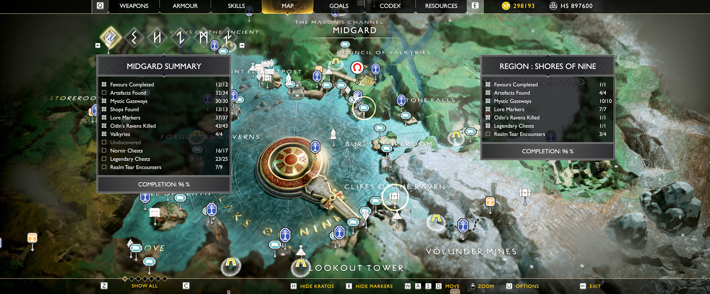
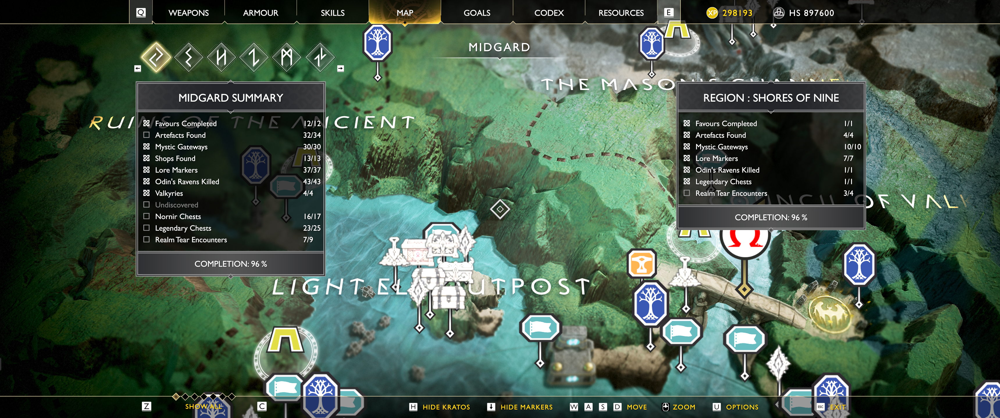
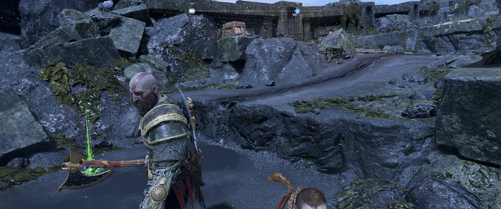

# Completionist Map for God of War (2018)

PC mod for **God of War (2018)**. Adds collectible pins to world map and compass. Tracks collected items, with custom art and distance display.

By **Terru03**. Public downloads, docs, screenshots, and support live here. Development source, research, capture logs, and build tools stay in private repo. Release ZIPs include runtime Lua and install scripts needed by mod.

## Downloads

| Release | Status | Download |
| --- | --- | --- |
| [v1.0.1](https://github.com/Terru03/completionist-map-gow2018-releases/releases/tag/v1.0.1) | Current stable | [CompletionistMap-v1.0.1.zip](https://github.com/Terru03/completionist-map-gow2018-releases/releases/download/v1.0.1/CompletionistMap-v1.0.1.zip) |
| [v1.0.2](https://github.com/Terru03/completionist-map-gow2018-releases/releases/tag/v1.0.2) | Test release / pre-release | [CompletionistMap-v1.0.2.zip](https://github.com/Terru03/completionist-map-gow2018-releases/releases/download/v1.0.2/CompletionistMap-v1.0.2.zip) |

[All releases](https://github.com/Terru03/completionist-map-gow2018-releases/releases) · [Nexus Mods](https://www.nexusmods.com/godofwar/mods/396) · [Changelog](CHANGELOG.md)

Get named release ZIP. GitHub's automatic **Source code** archives hold this docs repo; they do not hold mod package.

## Features

- Collectible pins on map, with custom compass art and live distance.
- Track one target; choose new target to replace it.
- Map show/hide toggle and collectible filters.
- Completion checks across map opens, reloads, and realm changes.
- Installer and uninstaller, with stock-file backups.

Custom families: Odin's Ravens; Nornir Chests, Seals, Bells, and Mechanisms; Legendary, Cipher, Wooden, and Red / Coffin Chests; Artefacts; Jötnar Shrines; Lore Markers and Scrolls; Realm Tears; Treasure Maps and Dig Sites.

Valkyries, Valkyrie Queen, Mystic Gateways, and Shops keep game's own pins. Mod does not set fake collectible or quest progress.

## Requirements and setup

- Windows 10 or 11, 64-bit.
- Supported game: **Steam 1.0.13 / GoW.exe 1.0.475.7534**. Other EXE builds not supported.
- **GoW Script Loader & Gameplay Tweaks 0.22** (`version.dll`) installed first.
- Avoid other mods that replace `dxgi.dll` or same map files.

Close game. Extract full release ZIP, then run `Install.bat`. Keep backup folder. Launch game and open map. Use `Uninstall.bat` to restore stock files.

See [full install, update, and removal steps](INSTALLATION.md). Installer can find Steam and Epic game folders; folder discovery does not mean other EXE builds supported.

## Screenshots

World map at Lake of Nine:

Collectible pins near Light Elf Outpost:

Compass in game:

[All five screenshots](screenshots/README.md)

## Support

[Report issue](https://github.com/Terru03/completionist-map-gow2018-releases/issues) or use [Nexus posts](https://www.nexusmods.com/godofwar/mods/396?tab=posts) / [Nexus bugs](https://www.nexusmods.com/godofwar/mods/396?tab=bugs).

Give mod version, Windows version, game build, install method, and exact error. For crash, add `GoW.exe` SHA256 and relevant log lines from `loader_log.txt` and `mods/completionist-map/native/raven-native-bridge.log`. Hide private paths and personal info. Do not upload game files or saves.

## Credits and reuse

- Terru03: mod, research, runtime code, marker art, and installer.
- Nukem: GoW Script Loader & Gameplay Tweaks.
- Santa Monica Studio and Sony Interactive Entertainment: God of War.

No separate open-source or artwork reuse licence granted. Ask author before reuse or redistribution. Game and third-party tools keep own rights.
